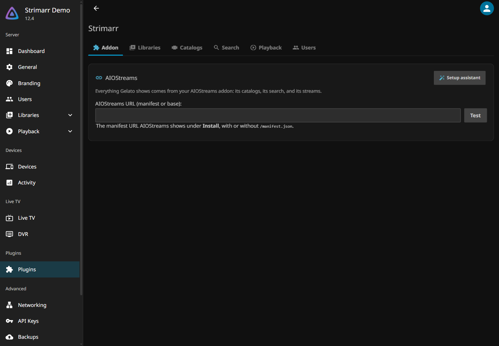
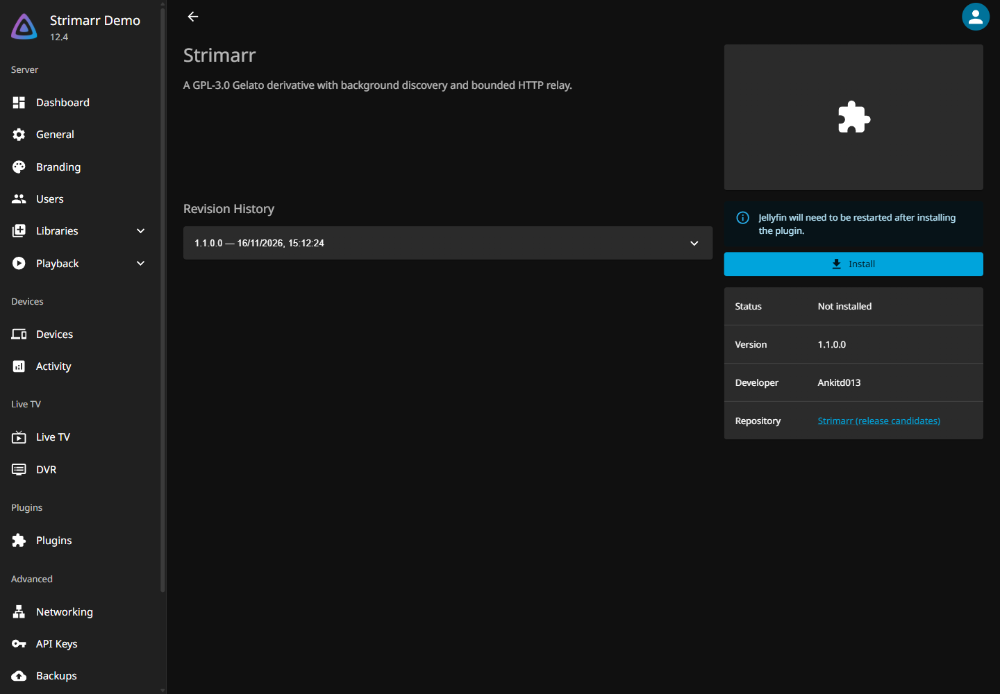

# Strimarr

### Your sources, inside Jellyfin. Metadata first.

Browse titles in Jellyfin while playable versions are found in the background. Choose a version with useful quality and language labels, then let Jellyfin handle playback.

**[Install](#install-from-the-jellyfin-dashboard)** · **[Illustrated setup guide](docs/QUICKSTART.md)** · **[Troubleshooting](docs/QUICKSTART.md#troubleshooting)** · **[Releases](https://github.com/Ankitd013/strimarr/releases)**



*Real screenshots from a clean demonstration server. No movie artwork, source credentials or personal library is shown. Some inherited labels still use the Gelato name; see [credits](#credits-and-license).*

## What you get

- **Details first:** metadata can appear while source discovery continues.
- **Useful version choices:** quality, source and available language information instead of repeated quality-only names.
- **All languages by default:** original-audio labels are preferred where supplied. Actual tracks depend on the source and probing.
- **Show hidden versions:** relax a title's language filter without changing everyone else's preferences. Requires the compatible browser helpers.
- **Help for some slow HTTP sources:** bounded parallel fetching for supported R2/Pixeldrain links. Results depend on the upstream host.
- **A plugin installation:** no patches to Jellyfin core, Seerr or Moonfin files.

## Before you install

You need **Jellyfin administrator access** and a **working [AIOStreams](https://github.com/Viren070/AIOStreams) configuration** with a source you are authorized to access. A metadata-only catalog can show titles but cannot supply video.

Strimarr is free. **No paid subscription, debrid account or paid source is required by the plugin or bundled with this guide.** External providers set their own requirements. AIOStreams and any optional Cloudstream bridge run separately; installing Strimarr does not install those services or supply a movie collection.

**Release candidate:** back up Jellyfin first. Disable/remove Gelato or the earlier private integration before switching—do not load both DLLs. [Migration instructions →](docs/SETUP.md)

## Install from the Jellyfin dashboard

**No terminal, SDK or manual DLL copying is needed for normal plugin installation.**

1. Sign in as an administrator. Open **Dashboard → Plugins → Manage Repositories → New Repository**.
2. Name it **Strimarr (release candidates)** and paste this URL:

   ```text
   https://raw.githubusercontent.com/Ankitd013/strimarr/main/repository-rc.json
   ```

3. Add it, return to **Plugins**, choose **Available**, and search **Strimarr**. Older interfaces may call this view **Catalog**.
4. Open Strimarr, select **Install**, and confirm Jellyfin's third-party-plugin prompt.
5. Restart Jellyfin when it is safe to interrupt playback. Refresh your browser.
6. Open **Plugins → Installed → Strimarr → Settings → Setup assistant**.



This URL opts into **release candidates**. The separate `repository.json` is reserved for stable releases and is currently empty. [Missing from the catalog? →](docs/QUICKSTART.md#troubleshooting)

## Finish setup

1. **Connect AIOStreams:** save its configuration, copy the HTTP(S) manifest link from **Install**, paste it into the assistant, and choose **Connect**.
2. **Pick libraries:** use existing libraries or create dedicated Movies/Shows libraries. Set a persistent, writable folder on the Jellyfin server.
3. **Choose catalogs:** start with one small catalog, or skip imports and use search.
4. **Review and finish:** keep media-info contribution off unless you opt in. Then grant the intended users access to the new libraries in Jellyfin's user settings.

**[Follow the full illustrated guide →](docs/QUICKSTART.md)**

## Jellyfin compatibility

Latest stable checked on **16 November 2026**: [Jellyfin 12.4](https://github.com/jellyfin/jellyfin/releases/tag/v12.4).

| Server | What has been verified |
| --- | --- |
| **12.4.0 — current stable** | Public `1.1.0.0` ZIP installed from the dashboard on a clean official Docker server; restart, Active status, Settings and assistant opening verified. |
| **12.3.0** | Earlier integration exercised with Jellyfin Web and Moonfin, including playback/audio switching. |
| **12.1–12.2** | API/build baseline is 12.1.0; no complete runtime validation recorded. |
| **Future releases** | Must be checked when released. Compatibility with every future API change cannot be promised. |
| **10.x** | Unsupported by this build. |

Dashboard installation on 12.4 is verified; every source/client/codec and full playback on 12.4 are not certified. [Validation record →](docs/COMPATIBILITY.md)

Extra Jellyfin Web discovery/hidden-version controls need the compatible [JavaScript Injector plugin](https://github.com/n00bcodr/Jellyfin-JavaScript-Injector). Moonfin/native clients can display different controls. Remote TMDB features need your own configured TMDB API key; none is shipped. [Optional setup →](docs/QUICKSTART.md#optional-features)

## Help and project information

| I want to… | Go here |
| --- | --- |
| Install/connect sources or troubleshoot | [Illustrated quick start](docs/QUICKSTART.md) |
| Migrate or change advanced settings | [Setup and migration](docs/SETUP.md) |
| Understand compatibility | [Validation record](docs/COMPATIBILITY.md) |
| Understand the bridge | [Architecture](docs/ARCHITECTURE.md) |
| Compare similar plugins | [Alternatives](docs/ALTERNATIVES.md) |
| Build or contribute | [Contributing](CONTRIBUTING.md) |
| Report a problem | [Issues](https://github.com/Ankitd013/strimarr/issues) — remove tokens, cookies and signed URLs first |

## Credits and license

Strimarr is a **modified [Gelato v0.26.30.2](https://github.com/lostb1t/Gelato/tree/v0.26.30.2) derivative**, distributed under [GPL-3.0](LICENSE). Gelato supplies the integration foundation; its license and attribution are retained. Changes are recorded in [CHANGELOG.md](CHANGELOG.md). Strimarr modifications are published by Ankit / Clawiz.

Jellyfin, AIOStreams, Cloudstream, Moonfin and Seerr are independent projects; this is not their official or endorsed product. Screenshot interfaces remain attributed to their respective authors. No media files, film artwork, provider backups, session cookies, proprietary bridge binaries or paid-service credentials are bundled.

Use sources you are authorized to access. License compliance and careful asset selection reduce avoidable issues but cannot guarantee immunity from copyright, trademark or DMCA claims. [Rights and screenshot provenance →](docs/RIGHTS.md) · [Distribution notices →](NOTICE.md)
