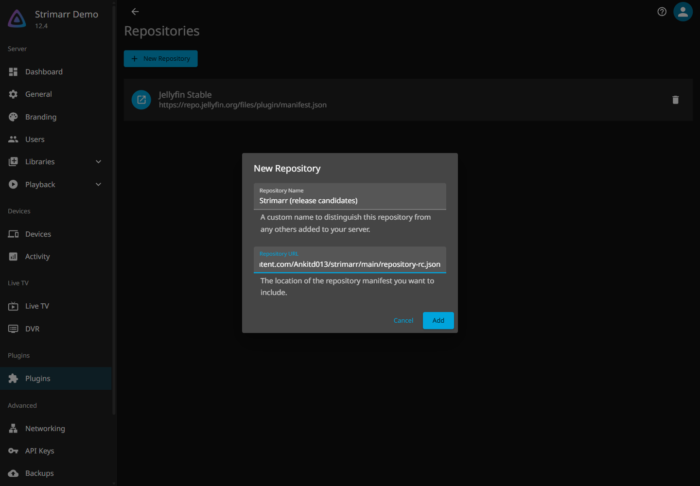
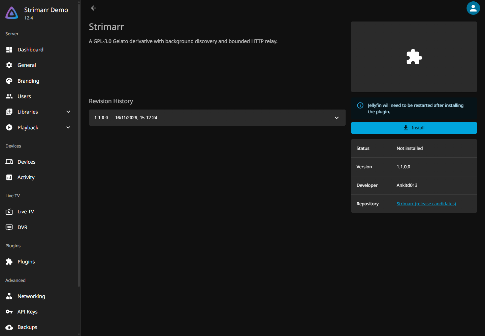
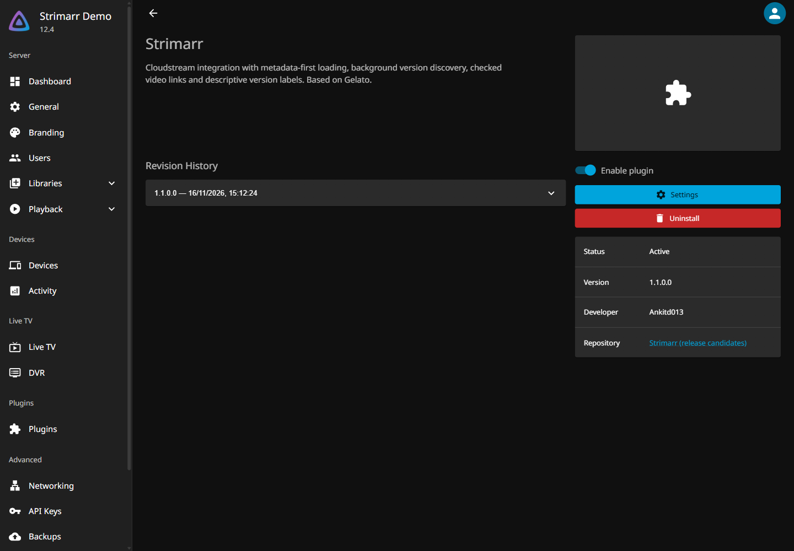
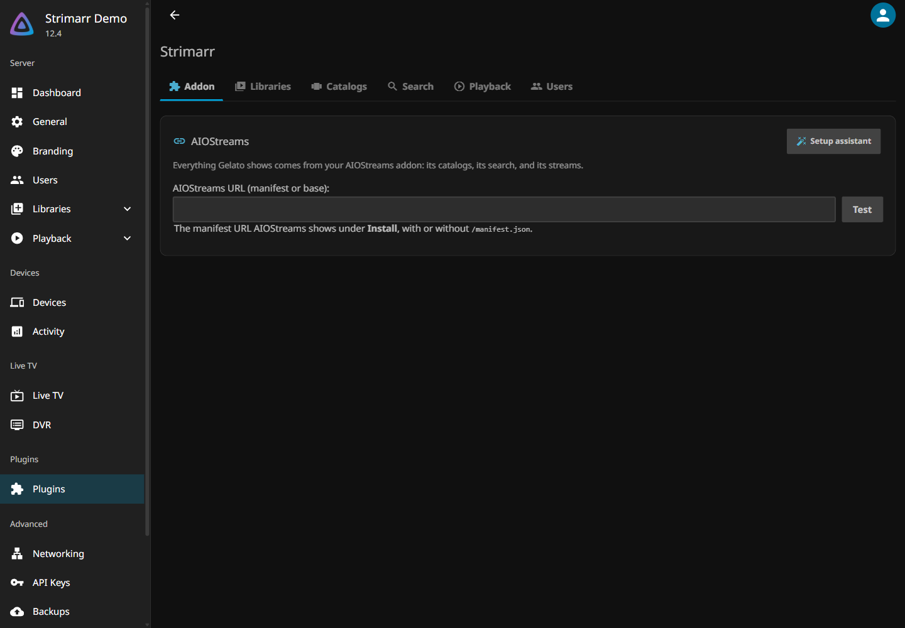
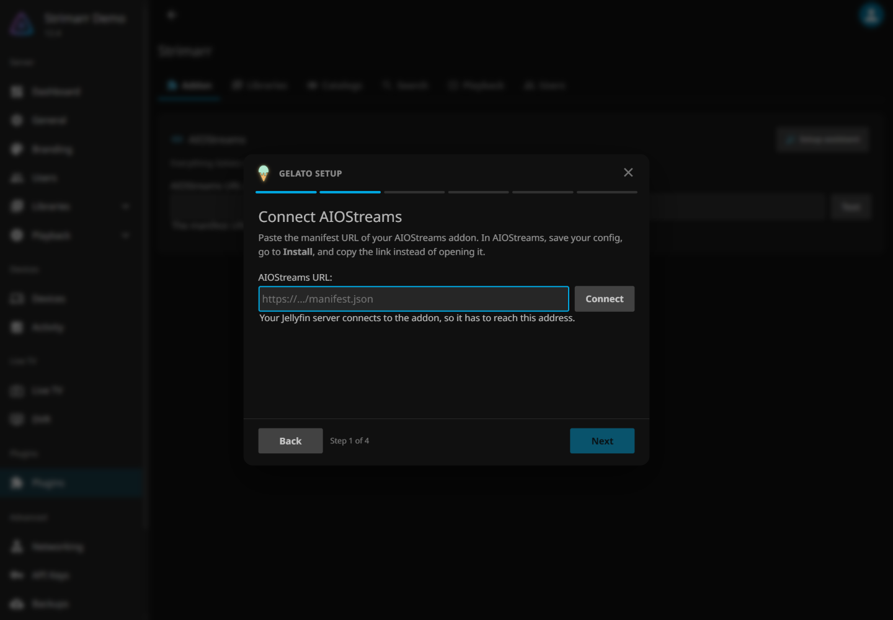
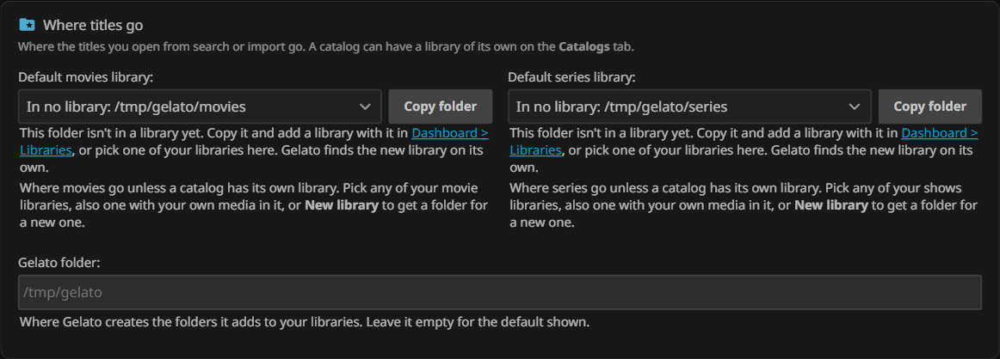

# Set up Strimarr in Jellyfin

[← Back to README](../README.md)

This guide uses **Jellyfin 12.4**, checked on **16 November 2026**. Normal installation uses the dashboard; compiling the plugin is unnecessary.

## 1. Prepare your sources

Strimarr connects Jellyfin to a separately running **AIOStreams** instance. If you already use AIOStreams, keep that instance and configuration. Otherwise, follow the [AIOStreams documentation](https://aiostreams.org/) and [official repository](https://github.com/Viren070/AIOStreams) to install/configure it.

Enable a metadata/catalog addon and at least one addon that supplies playable HTTP streams you are authorized to access. No paid service is required by this guide. Catalogs and stream sources serve different purposes: a visible title does not prove that a video is available.

In AIOStreams, save the configuration, open **Install**, and copy the configured **HTTP(S) manifest URL**. Keep it private: it can contain configuration/access credentials. Copy the HTTP link instead of launching Stremio. If you only have a `stremio://` link, use AIOStreams' HTTP install-link option.

Your **Jellyfin server** must reach the URL. In Docker, `localhost` points at Jellyfin's own container. Use a reachable hostname/shared-network service name. A URL working in your desktop browser does not prove that Jellyfin can reach it.

Cloudstream is optional: obtain [CNCVerse Bridge](https://github.com/NivinCNC/CNCVerse-Bridge) from its publisher, review its separate terms, and connect its addon through AIOStreams. Strimarr does not bundle the bridge, extensions, provider lists or accounts. A Pixel/ADB connection is unnecessary for a fresh setup.

## 2. Add the repository

1. Back up Jellyfin's configuration/database. For an existing Gelato/private integration, follow [migration guidance](SETUP.md) first.
2. Sign in as an administrator. Open **Dashboard → Plugins → Manage Repositories → New Repository**.
3. Name it **Strimarr (release candidates)**, paste this URL, and choose **Add**:

```text
https://raw.githubusercontent.com/Ankitd013/strimarr/main/repository-rc.json
```



Copy the code block: the screenshot's single-line URL field scrolls horizontally. Add Strimarr alongside Jellyfin's official repository; do not replace the official one.

## 3. Install and restart

1. Return to **Plugins → Available**, search **Strimarr**, and open its card. Older interfaces may call this view **Catalog**.
2. Choose **Install**, confirm Jellyfin's third-party-plugin prompt, and wait for installation to finish.
3. Restart Jellyfin when current playback can be interrupted. Docker/host-managed installations may require restarting the service/container from their normal management interface.
4. Refresh your browser. Open **Plugins → Installed → Strimarr** and check for **Active** status.





If the page briefly still says **Restart**, reopen/refresh Plugins after startup. If it remains inactive, inspect server logs and compatibility before reinstalling. Do not keep Gelato or an older integration DLL loaded alongside Strimarr.

## 4. Run the setup assistant

Choose **Settings**. The assistant may open automatically on a fresh installation. For a permanent installation, first prepare its storage:

1. Close the automatically opened assistant for now.
2. In **Addon**, paste your AIOStreams manifest URL and choose **Test**.
3. In **Libraries → Gelato folder**, set a persistent, writable path inside Jellyfin's filesystem. For example, `/config/strimarr` works only when `/config` is persistent and writable in your installation. On Windows, use a persistent folder accessible to the Jellyfin service account.
4. Choose **Save** in the unsaved-changes bar. Then return to **Addon → Setup assistant**.

This avoids creating your libraries under the temporary evaluation folder.

Some inherited labels say **Gelato setup**. This is expected in `1.1.0.0`: Strimarr is a Gelato derivative and retains those labels/internal identifiers. You do not need a second plugin.



### Connect AIOStreams

Paste your private manifest URL from step 1 and choose **Connect**. Continue with **Next** after it is recognized. For a failed connection, check the URL, service reachability and TLS certificate before continuing.



### Pick libraries and a persistent folder

Choose existing movie/series libraries, or let the assistant create new ones. Separate libraries are easier to understand for a first installation.

Use the persistent base folder prepared above. These folders hold small virtual/stub files, not downloaded movies. The default `/tmp/gelato` shown below is for evaluation and can disappear. For an existing deployment, follow migration guidance instead of casually changing paths.



If adding libraries manually, copy the generated folder paths into **Dashboard → Libraries → Add Media Library**. Use the appropriate movie/series content types. Where required, put the inherited Gelato providers first in that library's metadata/image provider settings. Keep existing local libraries intact.

### Choose catalogs

A catalog is a list of titles supplied by an addon. Start with one small catalog and wait for its initial import before adding more. You can skip imports and use search. Large lists and artwork can increase first-import time.

### Review and finish

Review the choices, leave **Contribute to RemuxDB** off unless you choose to opt in, and finish. If **Import the catalogs now** is selected, wait for the background task. No selected catalog means there is nothing to import; that is not an error.

## 5. Give other users access

Open **Dashboard → Users**, select each intended account, and allow access to the new movie/series libraries. A non-admin account cannot see a library it has not been granted.

The global addon configuration is shared by default. Use Strimarr's **Users** tab only for a different addon URL/library mapping. Users do not need administrator privileges to browse/play an allowed library.

## 6. Choose versions and audio

Open a title from search or an imported catalog. Details may appear before versions are ready. When results arrive, select the desired version, then use the player's audio menu if that version contains multiple tracks.

All languages are allowed by default. “Original Audio” is a source-provided label, not a guarantee. Probe results and client capabilities determine available tracks; another version may be needed for a missing language.

With a language filter enabled, the compatible Jellyfin Web helper can show **hidden versions** for one title. This relaxes language filtering, not link/network safety checks, and cannot recover sources that returned no results.

## Optional features

- **Browser helpers:** install the compatible [JavaScript Injector plugin](https://github.com/n00bcodr/Jellyfin-JavaScript-Injector) using its instructions. Enable the desired Strimarr script options. Extra Jellyfin Web discovery/hidden-version controls need it; basic dashboard settings do not. Moonfin/native clients can differ.
- **TMDB metadata:** configure your own free TMDB API key in Jellyfin's TMDB plugin or set `STRIMARR_TMDB_API_KEY` on the Jellyfin service. No key is included here.
- **Parallel fetching:** enabled for selected progressive HTTP hosts. Its loopback URL must match Jellyfin's internal port/base path. [Advanced settings →](SETUP.md#advanced-settings)
- **Seerr requests:** optional; Seerr is not needed for setup and does not supply streams. [Service chain →](SETUP.md#service-chain)

## Troubleshooting

| Problem | What to check |
| --- | --- |
| Missing from Plugins | Use `repository-rc.json`, not the empty stable catalog. Refresh and clear category/search filters. Check supported server version and server access to GitHub. |
| Installation fails | Check logs, plugin-folder permissions, network/TLS access to GitHub release assets, and compatibility. Manual installation is the fallback below. |
| Restart/inactive status persists | Wait for startup, refresh Plugins, check logs and duplicate DLLs. |
| AIOStreams will not connect | Copy its configured HTTP manifest URL again. Check reachability from Jellyfin's container/host, not just your browser. |
| Gelato appears in settings | Inherited labels are expected. The installed plugin should be Strimarr, GUID `b137092c-cc78-4c6e-b1a5-c3a1aa587a1d`. |
| Details work but no version arrives | Catalogs can work while stream sources fail. Test a lawful known-good source in AIOStreams, check language filters, and retry after the lookup cooldown. |
| Only the admin sees titles | Check each user's library access and Strimarr per-user override. |
| Audio change stops playback | Check FFmpeg logs, codecs and transcoding permissions; try another version. Parallel fetching cannot fix unsupported codecs or absent tracks. |
| Extra web buttons missing | Check compatible JavaScript Injector and script options. Refresh/clear stale site data if needed. This does not fix an upstream outage. |
| Imports/browsing are slow | Start with a small catalog; consider lazy images. Metadata-first loading cannot remove source extraction time. |

Report plugin/server/client versions, steps and **sanitized** logs. Remove tokens, cookies, configured addon URLs, signed video URLs and personal information. [Open an issue](https://github.com/Ankitd013/strimarr/issues).

## Manual installation fallback

Download the plugin ZIP and `SHA256SUMS` from the [matching release](https://github.com/Ankitd013/strimarr/releases), verify its checksum, stop Jellyfin, and extract into its plugin directory under `Strimarr_1.1.0.0`. Restart and follow step 4. Use [Jellyfin's official plugin documentation](https://jellyfin.org/docs/general/server/plugins/) for platform-specific paths.

Do not delete the configuration XML or existing libraries just to update a DLL. Use [SETUP.md](SETUP.md) for migration/rollback.
